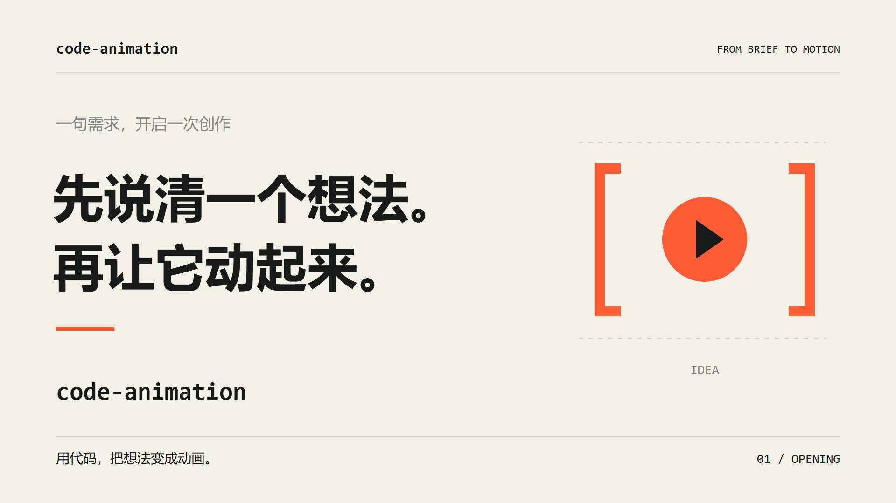
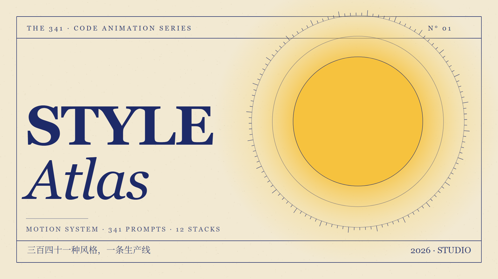

# Code Animation Studio 代码动画工坊

一个面向支持 Agent Skills 的编程助手的动画制作技能。把主题或脚本展开为视觉方向、分镜和关键帧，用 HTML/Canvas 制作动画，输出 MP4、封面与可编辑源文件。

基础渲染在本机运行，不需要安装 npm 依赖。配音是可选扩展，需要自行接入语音工具或提供音频文件。

## 示范案例

### 三分钟动画介绍片

以下效果图与视频为使用本技能制作的示范案例。成片为 1920×1080、180 秒，包含 AI 合成女生旁白、配乐与字幕。



[观看示范视频：code-animation 三分钟动画介绍片（MP4）](docs/media/code-animation_1080p_female.mp4)

### 8 秒动画示例



[查看 8 秒示例视频](examples/biennale-yellow/out/video.mp4) · [示例源码](examples/biennale-yellow/index.html) · [制作说明](examples/biennale-yellow/notes.md)

## 适合做什么

- 频道片头、动态海报、品牌标题卡。
- 知识讲解、数据叙事与产品介绍中的二维图形动画。
- 需要先看关键帧、再确定运动方向的创作流程。

需要实拍、真人拍摄或复杂三维建模的项目，应搭配其他制作工具。成片质量取决于编程助手、需求和迭代，不承诺任意模型一次生成即可达到相同效果。

## 公开版本包含什么

- `SKILL.md`：需求、风格、分镜、关键帧、动画与验收的工作流程。
- `references/`：12 套风格组合摘要、制作规范、质量评分与提示词配方。
- `assets/stage.html`：由时间驱动的 Canvas 舞台，支持暂停和指定时刻取帧。
- `scripts/`：环境诊断、建项目、静态检查、渲染、成片验证和发布包检查。
- `templates/` 与 `examples/`：需求模板、提示词模板和可运行示例。

可选资料库的原始目录含 341 个风格条目文件和 193 张预览图，其中 8 条尚无正文。**这些原文与图片的分发授权尚未逐项核验，默认不进入公开仓库或核心发布包。** 公开版可以直接使用 12 套组合摘要规划原创画面；可选库缺失时不会要求读取不存在的文件。详情见 [资料库说明](library/README.md) 和 [来源记录](SOURCES.md)。

## 环境依赖

- **Node.js 22.15 或更高版本**；本项目当前实测 Node.js 24。
- **Chrome 或 Edge**；脚本会查找常见安装位置，也可设置 `CHROME_PATH`。
- **完整 FFmpeg 与 FFprobe**；视频编码需要 `libx264`，有音轨时需要 AAC 编码器。
- 对应语言的系统字体。中文示例使用系统字体回退，不分发字体文件。

Windows 是当前本地实测平台。macOS/Linux 提供路径探测与命令支持，其兼容性还需要持续验证。跨系统的字体和浏览器版本可能影响像素结果；确定性指在相同资源与运行环境中，同一 `t` 可复现。

安装 FFmpeg 的常见方式：

```powershell
# Windows PowerShell
winget install --id Gyan.FFmpeg
```

```bash
# macOS
brew install ffmpeg
# Debian / Ubuntu
sudo apt-get install ffmpeg
```

从项目根目录检查环境：

```bash
node scripts/doctor.mjs
```

如自动探测失败，在当前终端设置可执行文件的绝对路径：

```powershell
$env:CHROME_PATH = 'C:\Program Files\Google\Chrome\Application\chrome.exe'
$env:FFMPEG_PATH = 'C:\ffmpeg\bin\ffmpeg.exe'
$env:FFPROBE_PATH = 'C:\ffmpeg\bin\ffprobe.exe'
```

```bash
export CHROME_PATH=/path/to/chrome
export FFMPEG_PATH=/path/to/ffmpeg
export FFPROBE_PATH=/path/to/ffprobe
```

## 安装为 Skill

下载发布包或克隆自己的仓库，把包含 `SKILL.md` 的整个文件夹命名为 `code-animation-studio`，放入宿主支持的技能目录。常见的项目级位置为 `<项目>/.agents/skills/code-animation-studio/`；个人级位置以宿主文档为准。

重新载入会话后，明确请求使用 `code-animation-studio`。宿主需要具有本地文件、命令执行和图片查看能力；纯聊天环境不能直接运行本机渲染脚本。

可以复制下面的需求：

```text
使用 code-animation-studio 制作一条动画。
主题：我的个人频道片头
主标题：我的频道
时长：8 秒
画幅：16:9，1920×1080
风格：由你根据主题选择
文案：由你起草
音轨：先做静音版
输出：MP4、封面、HTML 源文件
先检查环境，再提供分镜和至少三张关键帧。
等我确认画面方向后，再渲染成片。
```

这是一份需求模板；只有用户提出确认节点时才等待，不重复索取已经给出的授权。

## 从零跑通一个 8 秒项目

以下命令都从本项目根目录执行。默认舞台、生成的制作说明和示例命令统一为 **8 秒、1920×1080、24fps**。

```bash
# 1. 检查本机依赖
node scripts/doctor.mjs

# 2. 创建项目；输出放到默认忽略的 projects 目录
node scripts/new.mjs projects/my-film --title "我的频道" --duration 8

# 3. 编辑 projects/my-film/index.html 中的 SCENE 段
#    先修改标题与构图，然后做静态检查
node scripts/check.mjs projects/my-film/index.html

# 4. 只导出三张关键帧，查看图片后再继续
node scripts/render.mjs --html projects/my-film/index.html --stills 0,3,6 --no-encode --out projects/my-film/out/video.mp4

# 5. 渲染主片并导出封面
node scripts/render.mjs --html projects/my-film/index.html --fps 24 --poster 6 --out projects/my-film/out/video.mp4

# 6. 验证视频参数、解码和黑场
node scripts/validate.mjs projects/my-film/out/video.mp4 --duration 8 --fps 24 --width 1920 --height 1080
```

新项目的 `index.html` 是可运行的舞台示例，仍需改写场景才能成为自己的作品。生成的 `notes.md` 用于填写分镜与决定；`CREDITS.md` 用于记录外部素材。也可以先修改 `examples/biennale-yellow/index.html` 体验现成作品。

舞台支持 `?t=3` 查看第 3 秒，空格暂停/继续。默认 8 秒可以在 `CFG.duration` 中调整；`new.mjs --duration` 会同时更新舞台与说明。长片可以使用正数秒数，例如 `--duration 180`，但渲染量随帧数增长；3 分钟 24fps 共 4320 帧。

## 配音与音轨

基础技能支持规划声音，并将已有音频合入 MP4；核心发布包不内置语音模型，也不附带语音服务凭据。自然配音应先制作短段试听，再按段落和实际语音时长校准。

```bash
node scripts/render.mjs --html projects/my-film/index.html --audio projects/my-film/audio/mix.wav --out projects/my-film/out/video.mp4
node scripts/validate.mjs projects/my-film/out/video.mp4 --duration 8 --fps 24 --width 1920 --height 1080 --audio-required
```

`--audio` 合成视频音轨，不会自动把音频嵌入 HTML。若 HTML 也需离线有声播放，应把音轨嵌入文件或随项目提供，并检查播放器同步。使用在线语音服务时，应说明联网与额外依赖，并确认输出音频的使用条件。

## 排错与边界

- 找不到浏览器：设置 `CHROME_PATH` 后重跑 `doctor.mjs`。
- 找不到 FFmpeg/FFprobe：安装完整发行版，或分别设置对应环境变量；Playwright 自带的精简 FFmpeg 通常没有 H.264 编码器。
- 沙箱阻止浏览器启动：按宿主的授权流程允许本次本地渲染；不要把关闭浏览器沙箱作为默认操作。
- 中文变方块或换行不同：检查系统字体。源文件不携带商业字体文件。
- 横版转竖版：需要重新排版，再改变 Canvas 尺寸；修改输出宽高不会自动完成重排。
- 渲染慢：减少逐帧纹理和复杂效果，先出静帧；以本机测量为准，不把固定耗时当作保证。

`check.mjs` 是静态规则检查，不能证明画面质量或完整 JavaScript 正确性；仍需实际打开 HTML、检查关键帧和验证 MP4。

## 许可证与素材来源

项目自有代码与文档采用 [MIT License](LICENSE)，允许依照许可证使用、修改和分发，包括商业使用。适用范围与第三方排除项见 [LICENSE-SCOPE.md](LICENSE-SCOPE.md)。

MIT 不会替第三方文本、图片、音频或字体授予权限。未核验资料、用户项目和本地依赖被排除出默认公开内容。添加素材前请补齐 [SOURCES.md](SOURCES.md) 中的来源与授权记录；“仅供学习”或保留链接不能替代分发许可。

## 贡献与发布

贡献约定见 [CONTRIBUTING.md](CONTRIBUTING.md)，版本记录见 [CHANGELOG.md](CHANGELOG.md)，发布步骤见 [RELEASING.md](RELEASING.md)。

```bash
npm test
node scripts/release.mjs --check
node scripts/release.mjs
```

发布脚本生成 `dist/` 下的核心版本目录，采用固定文件范围，不打包本地 `projects/`、可选库原文、依赖和制作中间文件。发布到 GitHub、创建仓库或上传 Release 由维护者另行操作。
